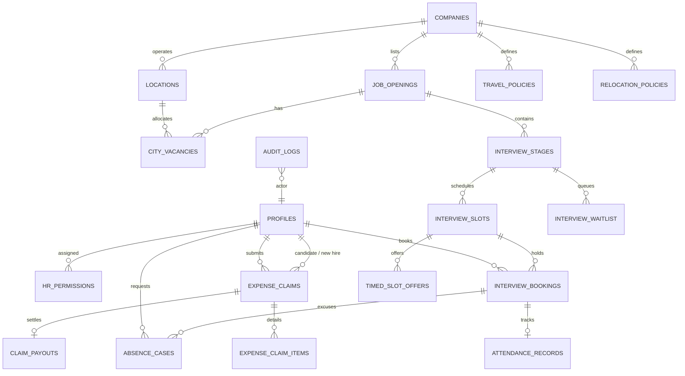

# HireSlot Backend Architecture & Interface Specification Contract

**Role:** Senior Backend Engineer & Database Architect  
**Target Platform:** Supabase PostgreSQL, Supabase Auth, Supabase Storage, PL/pgSQL  
**Status:** **PROPOSED & READY FOR TEAM LEADER SIGN-OFF**  

---

## 1. Executive Summary & Design Principles

HireSlot requires a secure, high-concurrency recruitment and interview lifecycle platform handling:
1. **Interview Slot Booking & City Vacancy Allocation** with zero race conditions (no double bookings, no capacity breaches).
2. **Interview Waitlists & Timed Offers** with automatic expiration and queue promotion.
3. **Attendance & Absence Cases** with proof attachments in private storage.
4. **Financial Claim Management** with strict separation between **Interview Travel** and **Employee Relocation**, policy enforcement (eligibility, caps, fixed allowance vs actual expenses), HR review, and payroll payout tracking.
5. **Multi-Tenant / Scoped RBAC Security**: Candidates only see their own records; HR access is strictly scoped to assigned `(company_id, location_id)`; financial decisions cannot be forged from client-side.
6. **Data Privacy**: No unmasked banking numbers stored or transmitted; sensitive operations logged immutably to `audit_logs`.

---

## 2. Entity Relationship Model (ERD)



---

## 3. Shared Database Schema & Table Definitions

### 3.1. Enums & Custom Types
```sql
CREATE TYPE user_role AS ENUM (
    'candidate',
    'hr_staff',
    'interviewer',
    'payroll_officer',
    'admin'
);

CREATE TYPE hr_permission_level AS ENUM (
    'viewer',
    'manager',
    'admin'
);

CREATE TYPE slot_status AS ENUM (
    'open',
    'booked',
    'cancelled',
    'completed'
);

CREATE TYPE booking_status AS ENUM (
    'confirmed',
    'cancelled',
    'attended',
    'no_show'
);

CREATE TYPE waitlist_status AS ENUM (
    'waiting',
    'offered',
    'expired',
    'accepted',
    'cancelled'
);

CREATE TYPE timed_offer_status AS ENUM (
    'pending',
    'claimed',
    'expired',
    'declined'
);

CREATE TYPE attendance_status AS ENUM (
    'attended',
    'late',
    'absent_unexcused',
    'absence_excused',
    'absence_requested'
);

CREATE TYPE absence_case_status AS ENUM (
    'submitted',
    'under_review',
    'approved_reschedule',
    'rejected'
);

CREATE TYPE claim_category AS ENUM (
    'interview_travel',
    'employee_relocation'
);

CREATE TYPE reimbursement_method AS ENUM (
    'fixed_allowance',
    'actual_expenses'
);

CREATE TYPE claim_status AS ENUM (
    'draft',
    'submitted',
    'under_hr_review',
    'hr_approved',
    'hr_rejected',
    'payout_queued',
    'paid'
);

CREATE TYPE payout_status AS ENUM (
    'pending',
    'processed',
    'failed'
);
```

---

### 3.2. Detailed Table Structure

| Table Name | Primary Key | Key Foreign Keys & Constraints | Description |
| :--- | :--- | :--- | :--- |
| `profiles` | `id (UUID -> auth.users.id)` | Role check, email, full_name, phone | Extends Supabase auth; stores user profile and baseline role. |
| `companies` | `id (UUID)` | `name UNIQUE`, `code UNIQUE` | Organizations/employers. |
| `locations` | `id (UUID)` | `company_id -> companies(id)` | Physical branches/offices with city, state, country. |
| `hr_permissions` | `id (UUID)` | `user_id -> profiles`, `company_id -> companies`, `location_id -> locations (nullable for global)` | Scopes HR staff to specific company and optional location. |
| `job_openings` | `id (UUID)` | `company_id -> companies` | Requisitions with department, title, open status. |
| `city_vacancies` | `id (UUID)` | `(job_opening_id, location_id) UNIQUE` | Capacity quota per city: `total_capacity`, `allocated_count`. |
| `interview_stages` | `id (UUID)` | `job_opening_id -> job_openings` | Pipeline stages (e.g., Screening, Tech Round, Final HR). |
| `interview_slots` | `id (UUID)` | `stage_id -> interview_stages`, `interviewer_id -> profiles`, `location_id -> locations (nullable)` | Time slots with `max_capacity`, `booked_count`, `start_time`, `end_time`. |
| `interview_bookings` | `id (UUID)` | `(slot_id, candidate_id) UNIQUE` | Confirmed bookings for candidates; prevents duplicate active booking. |
| `interview_waitlist` | `id (UUID)` | `(stage_id, candidate_id) UNIQUE` | Queue for full slots with sequential position. |
| `timed_slot_offers` | `id (UUID)` | `slot_id -> interview_slots`, `candidate_id -> profiles` | Time-bound offer (`expires_at`, e.g., 30 mins) before releasing to next candidate. |
| `attendance_records`| `id (UUID)` | `booking_id UNIQUE -> interview_bookings` | Attendance status, check-in timestamp, notes, marked by interviewer/HR. |
| `absence_cases` | `id (UUID)` | `booking_id -> interview_bookings`, `candidate_id -> profiles` | Absence excuse requests, reason, doctor/flight proof document storage path, HR decision. |
| `travel_policies` | `id (UUID)` | `company_id -> companies`, `claim_category = 'interview_travel'` | Travel eligibility rules, cap, method (`fixed_allowance` vs `actual_expenses`), date validity. |
| `relocation_policies`| `id (UUID)` | `company_id -> companies`, `claim_category = 'employee_relocation'` | Relocation eligibility, cap, method, move window, date validity. |
| `expense_claims` | `id (UUID)` | `user_id -> profiles`, `policy_id -> travel/relocation_policies` | Submissions by candidates/employees. Tracks financial lifecycle. |
| `expense_claim_items`| `id (UUID)` | `claim_id -> expense_claims` | Line items with receipts stored in Supabase private bucket. |
| `claim_payouts` | `id (UUID)` | `claim_id UNIQUE -> expense_claims` | Payout tracking. Stores masked bank details (`bank_last_four`), payment reference, status. |
| `audit_logs` | `id (UUID)` | `actor_id -> profiles` | Immutable log of all administrative and financial mutations. |

---

## 4. Shared TypeScript Interfaces & Contract

```typescript
// Shared Types for Backend & Frontend Team
export type UserRole = 'candidate' | 'hr_staff' | 'interviewer' | 'payroll_officer' | 'admin';

export type ClaimCategory = 'interview_travel' | 'employee_relocation';
export type ReimbursementMethod = 'fixed_allowance' | 'actual_expenses';
export type ClaimStatus = 
  | 'draft' 
  | 'submitted' 
  | 'under_hr_review' 
  | 'hr_approved' 
  | 'hr_rejected' 
  | 'payout_queued' 
  | 'paid';

export interface Profile {
  id: string; // matches auth.users.id
  email: string;
  full_name: string;
  role: UserRole;
  phone?: string;
  avatar_url?: string;
  created_at: string;
}

export interface HrPermission {
  id: string;
  user_id: string;
  company_id: string;
  location_id?: string | null; // null = entire company
  permission_level: 'viewer' | 'manager' | 'admin';
}

export interface InterviewSlot {
  id: string;
  stage_id: string;
  interviewer_id: string;
  location_id?: string | null;
  start_time: string;
  end_time: string;
  max_capacity: number;
  booked_count: number;
  status: 'open' | 'booked' | 'cancelled' | 'completed';
}

export interface InterviewBooking {
  id: string;
  slot_id: string;
  candidate_id: string;
  status: 'confirmed' | 'cancelled' | 'attended' | 'no_show';
  booked_at: string;
  cancellation_reason?: string;
}

export interface CityVacancy {
  id: string;
  job_opening_id: string;
  location_id: string;
  total_capacity: number;
  allocated_count: number;
}

export interface TimedSlotOffer {
  id: string;
  slot_id: string;
  candidate_id: string;
  offered_at: string;
  expires_at: string;
  status: 'pending' | 'claimed' | 'expired' | 'declined';
}

export interface ExpenseClaim {
  id: string;
  claim_number: string;
  user_id: string;
  category: ClaimCategory;
  policy_id: string;
  booking_id?: string | null;
  status: ClaimStatus;
  claim_method: ReimbursementMethod;
  total_claimed_amount: number;
  approved_amount?: number;
  currency: string;
  submission_date?: string;
  hr_reviewer_id?: string;
  hr_decision_notes?: string;
  created_at: string;
}

export interface ClaimPayout {
  id: string;
  claim_id: string;
  payment_status: 'pending' | 'processed' | 'failed';
  payout_reference?: string;
  payout_amount: number;
  currency: string;
  bank_account_last4: string; // Masked - only last 4 digits
  bank_routing_code?: string; // Masked / code only
  processed_at?: string;
  processed_by?: string;
}
```

---

## 5. Atomic Concurrency & Database Function Specifications

All critical state transitions run inside **PostgreSQL `SECURITY DEFINER`** functions with explicit `search_path = public` and row-level locking (`SELECT ... FOR UPDATE`):

### 5.1. `book_interview_slot(p_slot_id UUID)`
- **Concurrency Control:** `SELECT * FROM interview_slots WHERE id = p_slot_id FOR UPDATE;`
- **Validation:**
  - Verify slot exists, is `open`, and `booked_count < max_capacity`.
  - Verify candidate has not already booked this stage or another slot at overlapping times.
- **Atomic Operations:**
  - `INSERT INTO interview_bookings (slot_id, candidate_id, status)`
  - `UPDATE interview_slots SET booked_count = booked_count + 1, status = CASE WHEN booked_count + 1 >= max_capacity THEN 'booked' ELSE 'open' END`
  - Record audit log entry.

### 5.2. `allocate_city_vacancy(p_job_opening_id UUID, p_location_id UUID, p_count INT)`
- **Concurrency Control:** `SELECT * FROM city_vacancies WHERE job_opening_id = p_job_opening_id AND location_id = p_location_id FOR UPDATE;`
- **Validation:** `allocated_count + p_count <= total_capacity`.
- **Atomic Operations:** Update `allocated_count = allocated_count + p_count`.

### 5.3. `offer_slot_to_next_waitlisted(p_slot_id UUID, p_validity_minutes INT DEFAULT 30)`
- Inspects available slot capacity.
- Selects the next active candidate from `interview_waitlist` ordered by `position ASC`.
- Inserts `timed_slot_offers` with `expires_at = now() + (p_validity_minutes || ' minutes')::interval`.
- Updates waitlist status to `'offered'`.

### 5.4. `claim_timed_slot_offer(p_offer_id UUID)`
- Atomically locks `timed_slot_offers` and `interview_slots`.
- Asserts `auth.uid() = candidate_id`, `status = 'pending'`, and `now() <= expires_at`.
- Creates confirmed booking, marks offer `'claimed'`, updates waitlist status `'accepted'`.

### 5.5. `review_absence_case(p_case_id UUID, p_decision absence_case_status, p_notes TEXT)`
- Validates that caller is HR authorized for the booking's company and location.
- Updates absence case and synchronizes attendance record.

### 5.6. `review_expense_claim(p_claim_id UUID, p_action TEXT, p_approved_amount NUMERIC, p_notes TEXT)`
- Enforces HR role and company/location permission.
- Verifies `p_approved_amount <= policy.cap_amount`.
- Cannot be initiated by the claimant (even if they are HR).
- Updates status to `hr_approved` or `hr_rejected`.

### 5.7. `record_claim_payout(p_claim_id UUID, p_payout_ref TEXT, p_bank_last4 TEXT, p_notes TEXT)`
- Restrict to `payroll_officer` or `admin`.
- Enforces that claim is in `hr_approved` status.
- Inserts/updates `claim_payouts`, masks sensitive bank details, marks claim as `paid`.

---

## 6. Row Level Security (RLS) Policy Architecture

| Table | Candidate Permissions | HR Staff Permissions | Payroll Officer Permissions |
| :--- | :--- | :--- | :--- |
| `profiles` | Read own; update phone/avatar | Read candidates & team members in assigned scope | Read candidates/employees for payouts |
| `interview_slots` | SELECT open slots for active jobs | ALL for assigned company/location | SELECT only |
| `interview_bookings`| SELECT own; INSERT via atomic RPC; CANCEL own | SELECT & UPDATE for assigned company/location | SELECT only |
| `attendance_records`| SELECT own | SELECT, INSERT, UPDATE for assigned company/location | No direct access |
| `absence_cases` | SELECT own; INSERT own with proof | SELECT & UPDATE for assigned company/location | No direct access |
| `travel_policies` | SELECT active policies | ALL for assigned company | SELECT active |
| `relocation_policies`| SELECT active policies | ALL for assigned company | SELECT active |
| `expense_claims` | SELECT own; INSERT/UPDATE (only when status = `draft`) | SELECT & review claims for candidates in assigned scope | SELECT approved claims; UPDATE payout stage |
| `expense_claim_items`| SELECT own; INSERT/DELETE (only when claim = `draft`) | SELECT for assigned claims | SELECT for approved claims |
| `claim_payouts` | SELECT own (status, amount, ref, masked last4) | SELECT for assigned company | ALL (record reference & payout confirmation) |
| `audit_logs` | No access | SELECT logs relevant to their company scope | SELECT financial logs |

---

## 7. Storage Bucket Security

1. **`claim-receipts` Bucket (Private):**
   - Storage path format: `{user_id}/{claim_id}/{filename}`
   - RLS Upload: Candidate can upload only into their own `{auth.uid()}/...` folder.
   - RLS Download: Candidate can download their own files; authorized HR & Payroll can download files for claims within their assigned scope.
2. **`absence-proofs` Bucket (Private):**
   - Storage path format: `{user_id}/{booking_id}/{filename}`
   - RLS: Candidate owns their uploads; HR in the assigned company/location can view.

---

## 8. Verification & Test Strategy

1. **Concurrency Test Suite (Node.js/pg/Jest):**
   - 20 concurrent booking requests against a slot with `max_capacity = 2`.
   - Asserts exactly 2 succeed and 18 fail or redirect to waitlist.
   - Asserts `booked_count = 2` without overbooking.
2. **Security & RLS Boundary Tests:**
   - Candidate attempting to update `expense_claims.status = 'hr_approved'` (must fail).
   - Candidate attempting to read another candidate's receipts or medical absence proofs (must fail).
   - HR staff in Location A attempting to approve claims or reschedule slots in Location B (must fail).
   - Tamper-proofing of bank account details and payout references.
